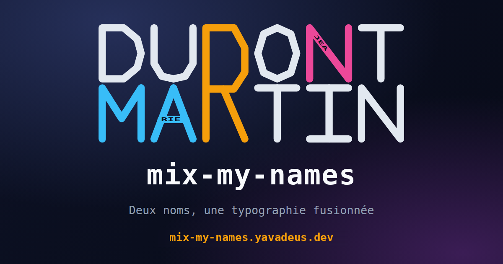

<div align="center">

# mix-my-names

### Deux noms, une typographie fusionnée.



**[mix-my-names.yavadeus.dev](https://mix-my-names.yavadeus.dev)**


</div>

---

Un générateur de **monogrammes typographiques**. Saisissez deux noms : les
lettres qu'ils ont en commun **fusionnent en un seul tracé** partagé, et le reste
de chaque nom se répartit au-dessus et en dessous. L'ensemble forme un rectangle
net. Les prénoms, eux, se **gravent en tout petit** le long d'un trait de la
lettre qui les rattache.

Tout est dessiné en **SVG**, avec une fonte à traits maison. 100% front-end,
aucun backend.

## Fonctionnalités

- **Fusion intelligente** des lettres communes (sous-séquence commune + contrainte
  de rectangle), avec choix automatique des lettres les plus rentables.
- **Lettres partagées pleine hauteur** qui appartiennent aux deux noms à la fois.
- **Inscription des prénoms** le long d'un trait de la lettre de jonction, dans
  n'importe quelle orientation (horizontale, verticale, diagonale).
- **Trois modes de couleur** : par lettre (communes / autres), par hauteur (mot du
  haut / mot du bas, avec lettres partagées bicolores) et par prénom.
- **Personnalisation** : couleurs des lettres, du fond, inversion des deux noms.
- **Entièrement dynamique** : changez un nom, la fusion, le crénage et les
  inscriptions se recalculent instantanément.

## Comment ça marche

| Étape | Fichier | Rôle |
|---|---|---|
| **Fusion** | `src/lib/fusion.ts` | Trouve les lettres communes fusionnables (LCS contraint par la parité des trous). |
| **Mise en page** | `src/lib/layout.ts` | Place les glyphes à partir des ancres, applique le crénage. |
| **Prénoms** | `src/lib/prenom.ts` | Accroche le reste du prénom sur la bonne lettre. |
| **Fonte** | `src/lib/glyphs/` | 26 lettres dessinées à la main (une par fichier). |

Exemple : **MASCHTALER** et **MARTIN** partagent `M`, `A` et `T` (fusionnés,
pleine hauteur) ; `ALEXANDRA` retient `ALE` et grave `XANDRA` sur la barre du `E`,
`KEVIN` retient `IN` et grave `KEV` sur le trait du `I`.

## Démarrage

```bash
make install   # installe les dépendances
make start     # serveur de dev sur http://localhost:1313
```

## Commandes

| Commande | Effet |
|---|---|
| `make start` | Serveur de dev (port 1313) |
| `make build` | Build de production |
| `make test` | Tests (Vitest + Testing Library) |
| `make check` | build + lint + typecheck + knip + tests |
| `make fix` | Format (Prettier) + lint (ESLint) |

## Stack

React 19 - TypeScript (strict) - Vite - Tailwind CSS v4 - Vitest - ESLint -
Prettier - Knip.

## Licence

MIT - YavaDeus
